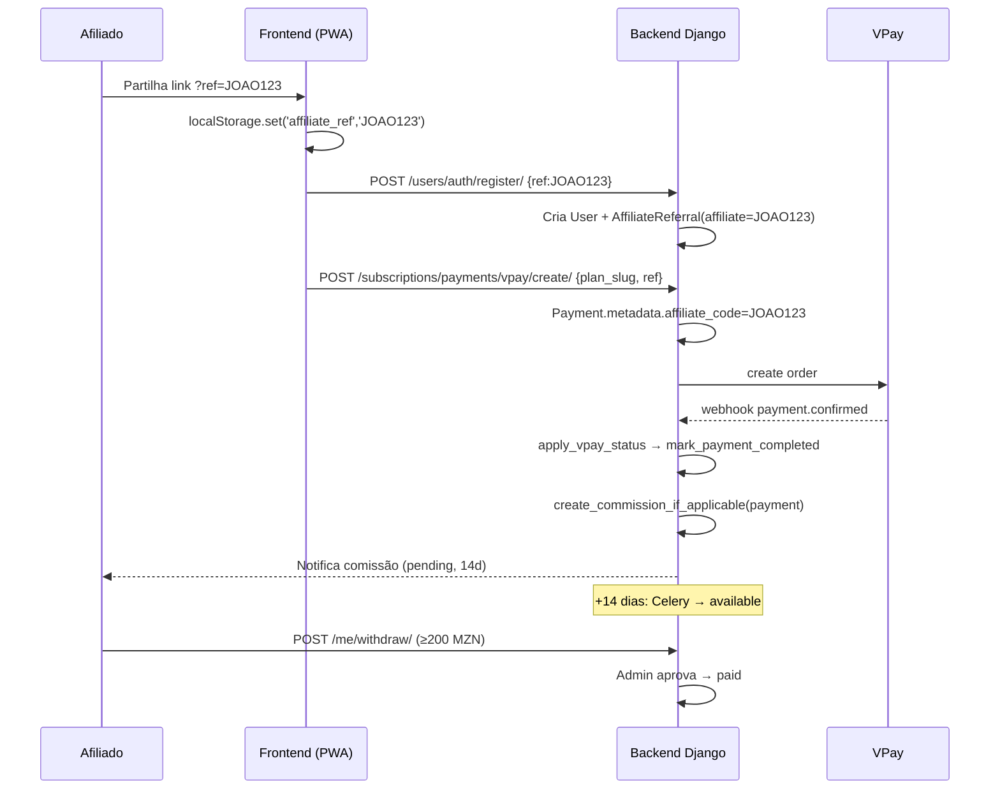

# 🚀 PLANO DE IMPLEMENTAÇÃO — SISTEMA DE AFILIADOS & COMISSÕES
## PlacarCerto — Infoproduto de Análise Matemática & Estatística de Futebol

> **Data:** 2026-10-22
> **Objetivo:** Criar e gerir um "exército de afiliados" capaz de vender o infoproduto PlacarCerto (análises matemáticas e estatísticas de futebol), gerando comissões automáticas assim que uma compra for concluída via **link de indicação** ou **código promocional**.
> **Posicionamento central:** Este é um **infoproduto de análise de dados**, NÃO um serviço de apostas. Toda a comunicação (interna e dos afiliados) deve usar linguagem educacional/analítica, nunca prometendo ganhos, odds, "dicas de aposta" ou resultados garantidos.

---

## Índice

1. [Entendimento do Negócio Atual](#1-entendimento-do-negócio-atual)
2. [Modelo de Negócio & Economia do Afiliado](#2-modelo-de-negócio--economia-do-afiliado)
3. [Jornada & Ciclo de Vida do Afiliado](#3-jornada--ciclo-de-vida-do-afiliado)
4. [Arquitetura Técnica](#4-arquitetura-técnica)
5. [Fluxos de Atribuição & Comissão](#5-fluxos-de-atribuição--comissão)
6. [Anti-Fraude & Integridade](#6-anti-fraude--integridade)
7. [Estratégia Operacional — o "Exército de Afiliados"](#7-estratégia-operacional--o-exército-de-afiliados)
8. [UI/UX — Design Mobile-First](#8-uiux--design-mobile-first)
9. [Roadmap de Implementação (Fases)](#9-roadmap-de-implementação-fases)
10. [Ficheiros Concretos a Criar/Alterar](#10-ficheiros-concretos-a-criaralterar)
11. [Legal, Compliance & Posicionamento](#11-legal-compliance--posicionamento)
12. [KPIs & Métricas de Sucesso](#12-kpis--métricas-de-sucesso)

---

## 1. Entendimento do Negócio Atual

### 1.1 O que é o PlacarCerto (arquitetura real)

| Camada | Tecnologia | Ficheiros-chave |
|---|---|---|
| Backend | Python 3.11 + Django 5.2.9 + DRF 3.14 + SimpleJWT | `backend/apps/*` |
| Async | Celery 5.3.6 + Redis 7 + django-celery-beat | `backend/config/celery.py` |
| DB | PostgreSQL 15 (migrações Django ORM) | `backend/apps/*/migrations/` |
| Pagamentos | **VPay Moçambique** (checkout hospedado + webhook HMAC) | `backend/apps/subscriptions/vpay_*.py` |
| Frontend | React 19 + Vite 7 + React Router 7 + Tailwind CSS 3.4 + PWA | `frontend/src/*` |
| Auth cliente | JWT em `localStorage` + Axios interceptors | `frontend/src/services/api.js` |

### 1.2 O funil de monetização hoje

```
Visitante → Registo (freemium, 3 análises/dia)
         → Esgotar limite → ver Planos (PricingPage/PremiumPage)
         → CheckoutModal → POST /subscriptions/payments/vpay/create/
         → Redirect checkout VPay → Webhook/polling → Payment completed → Subscription ativa
```

**Planos (fonte da verdade = `backend/apps/subscriptions/plan_config.py`):**

| Slug | Nome | Preço (MZN) | Duração | Análises/dia |
|---|---|---|---|---|
| `teste` | Teste | 1 | 1 dia | 3 |
| `starter` | Starter | 299 | 30 dias | 15 |
| `pro` | Pro ⭐ | 599 | 30 dias | 40 |
| `vip` | VIP | 1499 | 90 dias | 80 |

### 1.3 Pontos de integração existentes (onde o sistema de afiliados "encaixa")

1. **Registo** — `RegisterView` → `UserRegistrationSerializer.create()` (`backend/apps/users/serializers.py`). Já aceita `fingerprint` via `request.data`. É o ponto natural para capturar `ref`/`promo_code` e associar ao `User`.
2. **Criação do pagamento** — `create_vpay_payment()` (`backend/apps/subscriptions/vpay_views.py`). Cria `Payment(..., metadata={...})`. O `metadata` (JSONField) é o local ideal para persistir a atribuição (`affiliate_code`, `affiliate_id`, `source`, `click_id`).
3. **Confirmação do pagamento** — `apply_vpay_status()` + `mark_payment_completed()` (`backend/apps/subscriptions/payment_helpers.py`). Este é o **único ponto idempotente** em que sabemos que a venda "aconteceu" → é aqui que a comissão deve ser calculada/disparada.
4. **Utilizador logado** — `AuthContext.jsx` mantém `user`; `api.js` centraliza todas as chamadas. Útil para guardar o código de afiliado em `localStorage` e injetá-lo no checkout.

> ⚠️ **Nota importante:** os docs `DESIGN_PAGAMENTOS.md` e `INTEGRACAO_PAGAMENTO_COMPLETA.md` estão **desatualizados** (descrevem PaySuite, gateway desativado). A verdade atual é o fluxo VPay acima. Qualquer implementação nova deve basear-se em `vpay_*.py`, nunca nos docs antigos.

---

## 2. Modelo de Negócio & Economia do Afiliado

### 2.1 Porque afiliados fazem sentido neste produto

- **Custo de aquisição baixo:** a comissão é variável e só paga na venda (não há risco de tráfego pago antecipado).
- **Margem alta (74–87%):** o custo marginal de servir um utilizador é ~0 (a análise é CPU/API), pelo que se pode pagar comissões agressivas sem perder dinheiro.
- **Produto digital escalável:** não há stock, logística nem limite de entrega.

### 2.2 Estrutura de comissão proposta (configurável)

| Nível | Tipo | Percentagem sugerida | Aplicável a |
|---|---|---|---|
| **Padrão** | Comissão única por venda | **40%** | starter, pro, vip |
| **VIP Afiliado** | Comissão elevada para top afiliados | **50%** | pro, vip |
| **Teste** | Plano de 1 MZN | **excluído** (0%) | evita pagar por testes |

> 💡 Comissões em **% do valor do plano** (não do lucro), calculadas **server-side** a partir de `plan_config.get_plan_price(slug)` — nunca confiar no cliente.

**Exemplo de ganhos (40%):**

| Plano vendido | Comissão do afiliado |
|---|---|
| Starter (299 MZN) | 119,60 MZN |
| Pro (599 MZN) | 239,60 MZN |
| VIP (1499 MZN) | 599,60 MZN |

### 2.3 Regras de negócio essenciais

1. **Atribuição "last-click" com janela de cookie:** o último afiliado que trouxe o utilizador (via link `?ref=CODE`) fica dono da comissão. Janela padrão de **30 dias** (configurável).
2. **Atribuição por código promocional:** o código digitado no checkout/registo tem prioridade sobre o cookie (intenção explícita do utilizador).
3. **Primeira compra vs renovação:** comissão padrão na **primeira compra** (aquisição). Renovações/recompras podem ter comissão menor (ex.: 10%) ou zero — recomendamos **comissão total na primeira venda** e **10% em renovações** para incentivar retenção.
4. **Auto-afiliado proibido:** um utilizador não pode ganhar comissão da própria compra.
5. **Estorno/reembolso = anulação da comissão:** se o `Payment` for `refunded`, a comissão associada é revertida (ou marcada como `reversed`).
6. **Valor mínimo de pagamento (threshold):** ex.: **200 MZN**. O afiliado só pode levantar a partir deste saldo, para reduzir custos operacionais de pagamento.
7. **Janela de anulação:** comissões ficam em estado **`pending`** durante **14 dias** (período de chargeback/refund), depois passam a **`available`**.

### 2.4 Mecanismo de pagamento aos afiliados

- **Fase 1 (MVP):** pagamento manual/via M-Pesa (e-Mola) a partir do painel admin — o admin marca como `paid`. Justificativa: evita construir integração de payout agora.
- **Fase 2:** payout automático via VPay payout/M-Pesa B2C se disponível, ou export CSV para processamento.

---

## 3. Jornada & Ciclo de Vida do Afiliado

```mermaid
flowchart LR
    A[Convite/Descoberta] --> B[Cadastro como Afiliado]
    B --> C[Painel do Afiliado]
    C --> D[Gera Link & Criativos]
    D --> E[Divulga em WhatsApp/IG/TikTok/Grupos]
    E --> F[Clique ?ref=CODE → cookie 30d]
    F --> G[Registo/Compra]
    G --> H[Atribuição + Comissão]
    H --> I[Saldo pending → available]
    I --> J[Levantamento M-Pesa/e-Mola]
    J --> K[Reinveste / escala]
```



**Estados do afiliado (operacional):** `Aplicado → Aprovado → Ativo → VIP → Suspenso`.

**Estados da comissão (técnico):** `pending → available → paid` (e `reversed` em refund).

---

## 4. Arquitetura Técnica

### 4.1 Novos modelos (Django)

Criar em `backend/apps/affiliates/models.py` (nova app `affiliates`):

```python
class Affiliate(models.Model):
    user = models.OneToOneField(User, on_delete=models.CASCADE, related_name='affiliate_profile')
    code = models.CharField(max_length=32, unique=True)          # ex.: "JOAO123"
    status = models.CharField(choices=[('active','Ativo'),('suspended','Suspenso')], default='active')
    tier = models.CharField(choices=[('standard','Padrão'),('vip','VIP')], default='standard')
    commission_rate = models.DecimalField(max_digits=5, decimal_places=2, default=0.40)  # 40%
    renewal_rate = models.DecimalField(max_digits=5, decimal_places=2, default=0.10)     # 10%
    total_earned = models.DecimalField(max_digits=12, decimal_places=2, default=0)
    available_balance = models.DecimalField(max_digits=12, decimal_places=2, default=0)
    pending_balance = models.DecimalField(max_digits=12, decimal_places=2, default=0)
    payout_method = models.CharField(max_length=20, default='mpesa')  # mpesa|emola|bank
    payout_account = models.CharField(max_length=60, blank=True)
    created_at = models.DateTimeField(auto_now_add=True)
    updated_at = models.DateTimeField(auto_now=True)

class AffiliateReferral(models.Model):      # liga o utilizador indicado ao afiliado
    affiliate = models.ForeignKey(Affiliate, on_delete=models.CASCADE, related_name='referrals')
    user = models.OneToOneField(User, on_delete=models.CASCADE, related_name='referred_by')
    code = models.CharField(max_length=32, blank=True)          # código usado
    source = models.CharField(max_length=20, default='link')    # link|promo_code
    click_id = models.CharField(max_length=64, blank=True)      # id do clique (anti-fraude)
    first_touch_at = models.DateTimeField(auto_now_add=True)
    last_touch_at = models.DateTimeField(default=timezone.now)
    converted_at = models.DateTimeField(null=True, blank=True)  # quando comprou

class AffiliateCommission(models.Model):
    affiliate = models.ForeignKey(Affiliate, on_delete=models.CASCADE, related_name='commissions')
    payment = models.OneToOneField('subscriptions.Payment', on_delete=models.CASCADE, related_name='affiliate_commission')
    referral = models.ForeignKey(AffiliateReferral, on_delete=models.SET_NULL, null=True)
    amount = models.DecimalField(max_digits=10, decimal_places=2)
    rate = models.DecimalField(max_digits=5, decimal_places=2)
    status = models.CharField(choices=[
        ('pending','Pendente'),('available','Disponível'),
        ('paid','Pago'),('reversed','Revertido')], default='pending')
    available_at = models.DateTimeField(null=True, blank=True)  # +14 dias
    paid_at = models.DateTimeField(null=True, blank=True)
    created_at = models.DateTimeField(auto_now_add=True)

class AffiliateClick(models.Model):        # registo de cliques (para analítica)
    affiliate = models.ForeignKey(Affiliate, on_delete=models.CASCADE)
    code = models.CharField(max_length=32)
    click_id = models.CharField(max_length=64, unique=True)
    ip = models.GenericIPAddressField(null=True, blank=True)
    user_agent = models.TextField(blank=True)
    created_at = models.DateTimeField(auto_now_add=True)
```

> **Alternativa sem nova app:** adicionar um `referred_by_code` no `User` e um `metadata.affiliate_code` no `Payment`. **Recomendação:** nova app `affiliates` — mais limpa, isolada e evolutiva.

### 4.2 Campos no `Payment.metadata` (sem alterar o modelo)

Ao criar o pedido em `create_vpay_payment()`, acrescentar:

```python
payment.metadata = {
    'plan': plan_slug,
    'plan_name': plan['name'],
    'gateway': 'vpay',
    # 👇 novos campos de afiliado
    'affiliate_code': affiliate_code,   # None se não houver
    'affiliate_id': affiliate_id,
    'referral_source': source,          # 'link' | 'promo_code' | None
    'click_id': click_id,
}
```

### 4.3 Atribuição — como o código viaja do clique à compra

**Camada 1 — URL / cookie (passivo):**
- Link do afiliado: `https://placarcerto.digital/?ref=JOAO123`.
- Frontend (`main.tsx`/`App.jsx` ou util) lê `URLSearchParams`, grava em `localStorage`:
  ```js
  const ref = new URLSearchParams(location.search).get('ref');
  if (ref) localStorage.setItem('affiliate_ref', ref);
  ```
- Ao registar e ao criar pagamento, o frontend envia o `ref` persistido.

**Camada 2 — Código promocional (explícito, prioridade máxima):**
- Campo opcional no `RegisterPage` e no `CheckoutModal`.
- Se preenchido, sobrescreve o cookie.

**Camada 3 — Server (resolução definitiva):**
- `RegisterView` aceita `ref`/`promo_code`, valida, cria `AffiliateReferral`.
- `create_vpay_payment()` lê o código (do corpo `ref` ou do `AffiliateReferral` existente) e grava em `metadata`.
- Ao completar (`apply_vpay_status → mark_payment_completed`), dispara `create_commission(payment)`.

### 4.4 Ponto de disparo da comissão (crítico)

Inserir a chamada em `payment_helpers.py` dentro do bloco idempotente:

```python
# payment_helpers.py — dentro de apply_vpay_status(), após mark_payment_completed()
if activate and payment.status == 'completed':
    activate_subscription_for_payment(payment)
    from apps.affiliates.services import create_commission_if_applicable
    create_commission_if_applicable(payment)   # idempotente via OneToOne
```

`create_commission_if_applicable()`:
1. Lê `payment.metadata['affiliate_code']`.
2. Valida: afiliado existe, `active`, não é o próprio comprador, plano ≠ `teste`.
3. Calcula `amount = plan_price * rate`.
4. Cria `AffiliateCommission(status='pending', available_at=now+14d)` (OneToOne garante idempotência).
5. Atualiza saldos do afiliado (`pending_balance`).
6. Marca `referral.converted_at`.
7. Regista log + notifica o afiliado (email/push).

### 4.5 Endpoints REST novos (app `affiliates`)

| Método | Rota | Permissão | Descrição |
|---|---|---|---|
| POST | `/api/affiliates/apply/` | IsAuthenticated | Candidatar-se a afiliado (gera `code`) |
| GET | `/api/affiliates/me/` | IsAuthenticated | Perfil, saldos, link, código |
| GET | `/api/affiliates/me/stats/` | IsAuthenticated | Cliques, conversões, comissões (gráficos) |
| GET | `/api/affiliates/me/commissions/` | IsAuthenticated | Lista de comissões |
| POST | `/api/affiliates/me/withdraw/` | IsAuthenticated | Pedir levantamento (≥ threshold) |
| POST | `/api/affiliates/track/` | AllowAny | Regista clique → devolve `click_id` + seta cookie |
| POST | `/api/affiliates/validate-code/` | AllowAny | Valida código promocional no checkout |
| GET | `/api/affiliates/admin/overview/` | IsAdminUser | Totais, top afiliados, pendentes |
| GET | `/api/affiliates/admin/commissions/` | IsAdminUser | Lista/export comissões |
| POST | `/api/affiliates/admin/commissions/{id}/approve/` | IsAdminUser | Marcar `available` |
| POST | `/api/affiliates/admin/commissions/{id}/mark-paid/` | IsAdminUser | Marcar `paid` |
| POST | `/api/affiliates/admin/affiliates/{id}/set-tier/` | IsAdminUser | Subir/descer tier (rate) |
| POST | `/api/affiliates/admin/affiliates/{id}/toggle-suspend/` | IsAdminUser | Suspender/reativar |

Registar no router em `backend/config/urls.py`:
```python
path('api/affiliates/', include('apps.affiliates.urls')),
```

### 4.6 Tarefas assíncronas (Celery)

- `release_pending_commissions` (diária): comissões `pending` com `available_at <= now` → `available`, atualizar saldos.
- `notify_affiliate_sale` (opcional): email/push quando há venda.
- `expire_referral_cookies`: limpeza de `AffiliateReferral` sem conversão após 30 dias (analítica).

---

## 5. Fluxos de Atribuição & Comissão



---

## 6. Anti-Fraude & Integridade

1. **Auto-compra:** comparar `affiliate.user_id == payment.user_id` → rejeitar.
2. **Click spam / self-referral via cookies:** validar IP/device; não permitir múltiplos `AffiliateReferral` do mesmo `user` (OneToOne).
3. **Atribuição dupla:** `AffiliateCommission` é `OneToOne` com `Payment` → impossível pagar duas vezes.
4. **Estorno:** no `Payment.status == 'refunded'`, reverter comissão (`reversed`) e subtrair do saldo.
5. **Plano `teste`:** excluído de comissão (impede farmar comissão de 1 MZN).
6. **Threshold + janela 14 dias:** mitiga chargeback.
7. **Rate limiting:** `track` endpoint com throttle (ex.: `anon 60/min`).
8. **Auditoria:** guardar `click_id`, IP, UA no `AffiliateClick`; `metadata.webhook_data` já existe no `Payment`.
9. **Suspensão:** admin pode suspender afiliado suspeito; comissões `pending` congelam.

---

## 7. Estratégia Operacional — o "Exército de Afiliados"

### 7.1 Perfil do afiliado ideal (para este infoproduto)

- **Criadores de conteúdo de futebol** (Instagram, TikTok, YouTube): já têm audiência qualificada.
- **Administradores de grupos WhatsApp/Telegram** de futebol (o canal de menor CAC, per a análise financeira).
- **"Influencers" de nicho** e micro-influencers (1k–50k seguidores) — custo baixo, confiança alta.
- **Estudantes/jovens** com redes sociais ativas — motivação de rendimento extra.
- **Bloggers/páginas de estatísticas** e dados esportivos.

### 7.2 Oferta de recrutamento (value prop para o afiliado)

- **Comissão alta (40–50%)** + comissão de renovação (10%).
- **Link próprio + código** com tracking em tempo real.
- **Kit de criativos prontos** (banners, stories, legendas, vídeos curtos) — reduz fricção.
- **Painel bonito** com ganhos, cliques e conversões.
- **Tier VIP:** quem atinge N vendas/mês sobe para 50% e ganha material exclusivo.
- **Pagamento rápido** via M-Pesa/e-Mola.

### 7.3 Kit de criativos e mensagens (posicionamento anti-aposta)

> ⚠️ **Regra de ouro de compliance:** os criativos devem dizer "análise estatística", "modelos matemáticos", "probabilidades", "dados de futebol" — **NUNCA** "ganhe dinheiro", "aposta certa", "odd garantida", "dica infalível".

**Exemplos de legendas permitidas:**
- ✅ "Descubra as probabilidades reais de cada jogo com modelos matemáticos (Poisson + Regressão). Teste grátis."
- ✅ "Dados e estatísticas de futebol que os analistas usam. Análises claras e fundamentadas."
- ❌ "Aposta garantida para hoje! Lucro certo." (proibido)

### 7.4 Estrutura operacional de gestão do programa

| Função | Responsável | Ferramenta |
|---|---|---|
| Recrutamento & onboarding | Gestor de afiliados (ou founder) | Formulário de candidatura + WhatsApp |
| Material & treino | Marketing | Kit de criativos + mini-guia de posicionamento |
| Aprovação & tiering | Admin | Painel admin `affiliates` |
| Pagamentos | Financeiro (ou founder) | Painel admin + M-Pesa manual |
| Compliance & fraude | Admin | Regras + revisão periódica |

### 7.5 Campanhas de recrutamento sugeridas

1. **Outreach direto** a criadores de conteúdo de futebol via DM (WhatsApp/IG).
2. **Programa "indique e ganhe" para utilizadores atuais:** qualquer subscritor pode virar afiliado.
3. **Desafios mensais:** top afiliado do mês ganha bónus (ex.: +10% no mês).
4. **Comunidade de afiliados** (grupo WhatsApp exclusivo) com novidades, rankings e tips de conteúdo.

---

## 8. UI/UX — Design Mobile-First

> A identidade do app é **mobile-first** (PWA, Tailwind, dark mode, paleta verde `#16a34a`). Todas as novas telas seguem o mesmo padrão: `card`, `input-field`, `page-container`, gradientes `primary-*`.

### 8.1 Nova secção "Programa de Afiliados" no app

**8.1.1 Registo do utilizador (fluxo do comprador)**

- **`RegisterPage.jsx`:** adicionar campo opcional **"Código de indicação (opcional)"** abaixo do telefone. Se o `ref` veio da URL, pré-preencher automaticamente.
- **`CheckoutModal.jsx`:** adicionar linha discreta **"Tem um código de indicação?"** que expande um campo. Mostrar um *check* verde quando o código é válido (`POST /validate-code/`).

**8.1.2 Entrada no programa (afiliado)**

- Botão **"Ganhe com indicações"** no `ProfilePage` e no footer.
- `AffiliateApplyPage` (`/affiliate/apply`): formulário simples (método de pagamento M-Pesa/e-Mola + número). Gera `code` automaticamente ao aprovar.
- `AffiliateDashboardPage` (`/affiliate`): **coração do programa**.

**8.1.3 Dashboard do afiliado (mobile-first)**

Layout de cartões empilhados (single column no mobile):

```
┌─────────────────────────────┐
│ 👋 Olá, João                │
│ Seu link: placarcerto.digital/?ref=JOAO123
│ [Copiar link] [Copiar código]
├─────────────────────────────┤
│ 💰 Saldo disponível: 359,40 MZN
│ ⏳ Pendente: 119,60 MZN   (libera em 14 dias)
│ [Levantar via M-Pesa]
├─────────────────────────────┤
│ 📊 Este mês
│  Cliques: 128   Conversões: 3   Receita: 839,00
│  [mini gráfico de barras 7 dias]
├─────────────────────────────┤
│ 🎨 Kit de criativos
│  [Baixar banner] [Copiar legenda] [Stories]
├─────────────────────────────┤
│ 📋 Últimas comissões
│  +119,60 MZN  Pro — 12/10  (disponível)
│  +239,60 MZN  VIP — 08/10  (pendente)
└─────────────────────────────┘
```

**Componentes novos (React):**
- `AffiliateLinkCard.jsx` — link + código + botões copiar (com feedback "Copiado!").
- `BalanceCard.jsx` — saldo disponível/pendente + CTA levantamento.
- `AffiliateStatsCard.jsx` — cliques/conversões/receita + gráfico (usar `lucide-react`, sem lib de gráfico pesada; barras com divs).
- `CreativeKitCard.jsx` — download/copy de criativos.
- `CommissionsList.jsx` — lista de comissões com estado colorido.
- `WithdrawModal.jsx` — pedido de levantamento (valida threshold).

**8.1.4 Painel admin**

Nova página `AdminAffiliates.jsx` (rota protegida `AdminRoute`):
- Totais (afiliados ativos, comissões pendentes/disponíveis/pagas).
- Tabela de afiliados (search, tier, suspender).
- Tabela de comissões com ações `approve` / `mark-paid`.
- Export CSV.

### 8.2 Regras de UI/UX mobile-first

- **Toque-friendly:** botões `py-4`, mínimo 44px de altura; CTAs grandes e full-width.
- **Dark mode** consistente (`dark:` variants).
- **Feedback imediato:** copy-to-clipboard, validação de código em tempo real, toasts.
- **Offline/PWA:** o dashboard deve ser legível com cache; os dados são carregados via `api.js` (axios).
- **Bottom sheet** para o campo de código promocional no checkout (melhor que modal full-screen no mobile).

---

## 9. Roadmap de Implementação (Fases)

### Fase 0 — Preparação (0,5 dia)
- [ ] Criar app Django `affiliates` (`python manage.py startapp affiliates`).
- [ ] Adicionar `affiliates` a `INSTALLED_APPS`.
- [ ] Escrever modelos + `makemigrations` + `migrate`.

### Fase 1 — Tracking & Atribuição (1–2 dias)
- [ ] Endpoint `track` + cookie/`localStorage` no frontend.
- [ ] Capturar `ref` no `RegisterView` e criar `AffiliateReferral`.
- [ ] Injetar `affiliate_code` no `Payment.metadata` em `create_vpay_payment()`.
- [ ] Campo "código de indicação" no `RegisterPage` e `CheckoutModal`.

### Fase 2 — Comissões (1 dia)
- [ ] `create_commission_if_applicable()` em `payment_helpers.py` (idempotente).
- [ ] Tarefa Celery `release_pending_commissions`.
- [ ] Lógica de refund → `reversed`.
- [ ] Testes unitários (compra normal, auto-compra, plano teste, refund, dupla compra).

### Fase 3 — Painéis (2–3 dias)
- [ ] `AffiliateDashboardPage`, `AffiliateApplyPage` (frontend).
- [ ] Endpoints `me`, `stats`, `commissions`, `withdraw`.
- [ ] `AdminAffiliates.jsx` + endpoints admin.

### Fase 4 — Criativos & Onboarding (1 dia)
- [ ] Kit de criativos (assets estáticos + legendas) servidos pelo frontend.
- [ ] Email/notificação de boas-vindas ao afiliado.

### Fase 5 — Operacional & Lançamento (contínuo)
- [ ] Processo de payout manual M-Pesa no admin.
- [ ] Comunidade WhatsApp + recrutamento.
- [ ] Monitorização de KPIs.

---

## 10. Ficheiros Concretos a Criar/Alterar

### Criar (nova app `backend/apps/affiliates/`)
```
backend/apps/affiliates/__init__.py
backend/apps/affiliates/models.py         # Affiliate, AffiliateReferral, AffiliateCommission, AffiliateClick
backend/apps/affiliates/services.py       # create_commission_if_applicable, validations
backend/apps/affiliates/serializers.py
backend/apps/affiliates/views.py          # apply, me, stats, commissions, withdraw, track, validate-code
backend/apps/affiliates/admin_views.py    # admin endpoints
backend/apps/affiliates/urls.py
backend/apps/affiliates/tasks.py          # release_pending_commissions (Celery)
backend/apps/affiliates/admin.py          # Django admin
backend/apps/affiliates/migrations/__init__.py
backend/apps/affiliates/tests.py
```

### Alterar (backend)
```
backend/config/settings.py          # INSTALLED_APPS += 'apps.affiliates'; configurações AFFILIATE_*
backend/config/urls.py              # include('apps.affiliates.urls')
backend/apps/users/serializers.py   # aceitar 'ref'/'promo_code' no registo
backend/apps/users/views.py         # criar AffiliateReferral no RegisterView
backend/apps/subscriptions/vpay_views.py   # persistir affiliate no Payment.metadata
backend/apps/subscriptions/payment_helpers.py  # disparar create_commission_if_applicable
```

### Criar (frontend)
```
frontend/src/pages/AffiliateDashboardPage.jsx
frontend/src/pages/AffiliateApplyPage.jsx
frontend/src/pages/admin/AdminAffiliates.jsx
frontend/src/components/affiliate/AffiliateLinkCard.jsx
frontend/src/components/affiliate/BalanceCard.jsx
frontend/src/components/affiliate/AffiliateStatsCard.jsx
frontend/src/components/affiliate/CreativeKitCard.jsx
frontend/src/components/affiliate/CommissionsList.jsx
frontend/src/components/affiliate/WithdrawModal.jsx
```

### Alterar (frontend)
```
frontend/src/App.jsx                 # rotas /affiliate, /affiliate/apply, admin
frontend/src/services/api.js         # affiliateAPI, promoCodeAPI
frontend/src/pages/RegisterPage.jsx  # campo código de indicação
frontend/src/components/CheckoutModal.jsx  # campo código + persistência ref
frontend/src/pages/ProfilePage.jsx   # link "Ganhe com indicações"
frontend/src/utils/affiliate.js      # helper para ler/persistir 'ref' na URL/localStorage
```

### Config (`.env`)
```
AFFILIATE_DEFAULT_RATE=0.40
AFFILIATE_RENEWAL_RATE=0.10
AFFILIATE_COOKIE_DAYS=30
AFFILIATE_PENDING_DAYS=14
AFFILIATE_MIN_WITHDRAWAL=200
AFFILIATE_EXCLUDED_PLANS=teste
```

---

## 11. Legal, Compliance & Posicionamento

1. **Posicionamento (obrigatório em toda a comunicação):** "PlacarCerto fornece **análises matemáticas e estatísticas de futebol** com fins informativos/educativos. Não é um serviço de apostas, não promove casas de apostas e não garante resultados."
2. **Termos do programa de afiliados** (`Terms`): regras de comissão, política anti-spam, proibição de promessas de ganhos, direito de suspensão.
3. **Proibição de linguagem de aposta nos criativos:** incluir checklist no kit de criativos e validação humana nas primeiras semanas.
4. **Conformidade com as plataformas** (WhatsApp/IG/TikTok) sobre promoção de produtos financeiros/apostas — manter linguagem analítica.
5. **Privacidade:** os dados de clique (IP/UA) devem respeitar a `PrivacyPage`; guardar o mínimo necessário.
6. **Nota de marketing:** atualizar os textos com `apostas`/`odds` no SEO para linguagem analítica, coerente com o novo posicionamento (ver `LandingPage.jsx`, `HomePage.jsx`, `PremiumPage.jsx`, `SEOHead.jsx`).

---

## 12. KPIs & Métricas de Sucesso

| Métrica | Definição | Alvo |
|---|---|---|
| Nº de afiliados ativos | afiliados com ≥1 clique/mês | crescer 10%/mês |
| CTR (cliques/link) | cliques ÷ exposições | > 2% |
| Taxa de conversão afiliado | vendas ÷ cliques | 2–5% |
| Custo por aquisição (CPA) | comissão média ÷ venda | ≤ 40% do preço |
| LTV/CAC | lifetime value ÷ custo de aquisição | > 3 |
| Receita via afiliados | % da receita total | 30–50% em 6 meses |
| Fraude detectada | nº de comissões revertidas | < 2% |
| Tempo de payout | dias de `available` → `paid` | < 7 dias |

---

## Resumo Executivo

Implementar um sistema de afiliados **baseado em link (`?ref=CODE`) + código promocional**, com **atribuição last-click de 30 dias**, **comissão de 40–50% na primeira venda** e **10% em renovações**, calculada **server-side** no momento idempotente da confirmação do pagamento (`apply_vpay_status`). A camada técnica assenta numa nova app Django `affiliates` (4 modelos + endpoints REST), integra-se nos 3 pontos existentes (registo, criação do pagamento, confirmação) sem quebrar o fluxo VPay, e entrega um **dashboard mobile-first** para o afiliado e um **painel admin** para gestão, payout manual e anti-fraude. Todo o programa é comunicado como **infoproduto de análise estatística**, nunca como serviço de apostas.
